# omaSon

**Unison for the Omarchy bar.** See exactly what will be synchronized before
anything moves, decide each change with one key, and sync, all from a panel
that looks and feels like the rest of Omarchy.

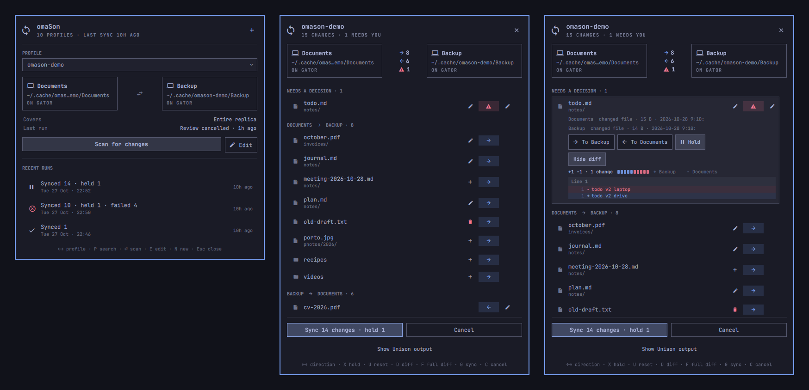

- **See the plan first.** Your two replicas face each other, with what flows
  each way, how much, and what needs you.
- **One key per decision.** `←`/`→` sends a change either way, `X` holds it,
  `U` restores Unison's suggestion. Conflicts come first.
- **Read the differences.** A diff preview in the row, and the full diff with
  line numbers when you want it.
- **Watch it happen.** The bar icon spins while Unison works, then switches to
  a check (or a conflict mark) and stays highlighted when a scan is ready for
  you. Rows are ticked off as transfers finish, and a notification tells you
  when a sync ends with the panel closed.
- **Manage profiles.** Create, edit, rename and delete Unison profiles, with
  live checks and Unison's own documentation for every preference.

Unison does the actual work: omaSon drives Unison's text interface and never
copies your files itself.

## Requirements

- Omarchy 4 (Quattro) with its bundled Quickshell plugin host
- Python 3 (ships with Omarchy)
- [Unison](https://github.com/bcpierce00/unison) — **not** bundled with Omarchy.
  Install it from your distribution (on Omarchy/Arch the package name is
  `unison`)
- For **Browse…** (folder chooser): the XDG desktop portal and `python-gobject`
  (both ship with Omarchy)
- For SSH replicas: keys loaded in the shell's SSH agent, the host already in
  `known_hosts`, and a compatible Unison on the remote. SSH replicas are
  supported but have not yet been tested against a real remote host.

No root privileges, packages beyond Unison, services, or installers are needed
to run the plugin itself.

## Install

Install the `unison` package first (see Requirements), then add the plugin:

```bash
omarchy plugin add https://github.com/ramoncardena/omason.git --enable
```

For local development, copy the working tree into the plugins folder (the
shell rejects symlinks) and enable it:

```bash
scripts/dev-sync.sh
```

Open the panel from the bar icon, or with:

```bash
omarchy-shell shell summon io.github.ramoncardena.omason '{}'
```

## Using omaSon

### Choose a profile

<p align="center">
  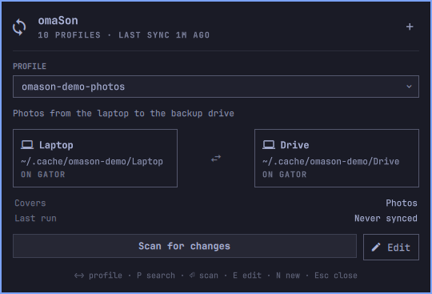
  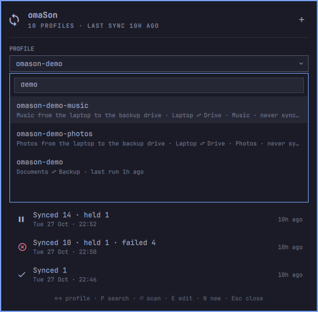
</p>

omaSon lists the Unison profiles in `~/.unison` (or the `UNISON` folder the
shell inherited). The panel opens on the profile you used last.

- **Pick a profile** with `←`/`→`, or press `P` to search. The search also
  matches descriptions, replicas and folders, so `drive` or `photos` work too.
- **The profile screen** shows the two replicas, what the profile covers, its
  last run and recent runs. A replica on an unplugged drive is shown as *not
  connected*, and scanning waits until it is back.
- **Scan for changes** (`R`, or `Enter` on the button) asks Unison what
  changed on each side.
  Nothing is copied until you press Sync.

### Review what will be synchronized

<p align="center">
  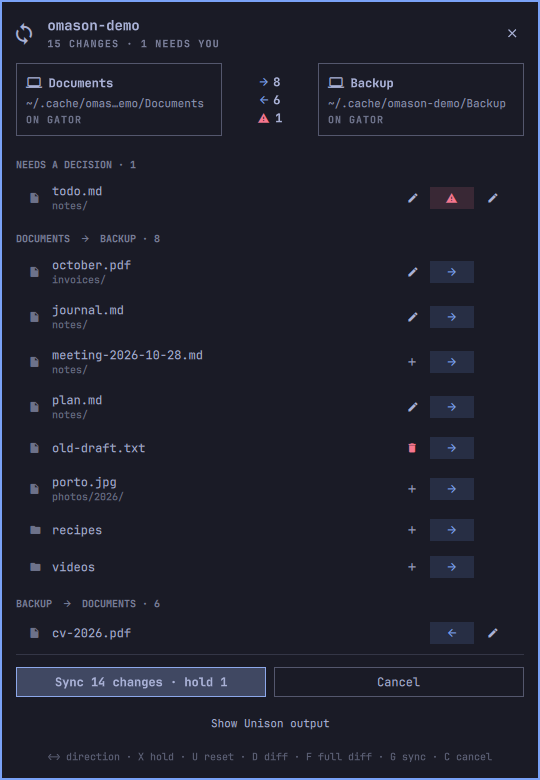
</p>

The two replicas face each other at the top, with the number of changes going
each way and, once Unison has totalled them, the bytes. Below, changes are
grouped:

- **Needs a decision**: conflicts (changed on both sides), merges and errors.
- **Left → right** and **right → left**: what Unison suggests copying, by
  direction. A row stays in its group when you change its direction, so the
  cursor never jumps.

Each row shows the file, what happened on each side (new, changed, deleted)
and a direction pill between them:

| Key | |
| --- | --- |
| `←` / `→` (or `H` / `L`) | Send the change to the left or right replica |
| `X` | Hold it: leave both sides as they are |
| `U` | Restore Unison's suggestion |
| `Enter` | Expand the row: size and date on each side, and the direction buttons |

Clicking the pill cycles through the directions. A direction can propagate a
deletion as well as a copy, and a changed direction is outlined so you can
see what you decided. The header and the Sync/Cancel buttons stay in place
while the list scrolls.

### Compare the two versions

<p align="center">
  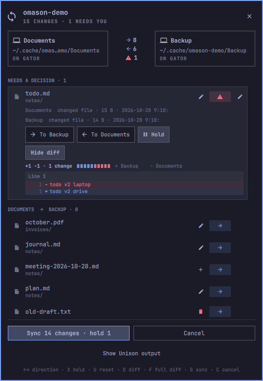
  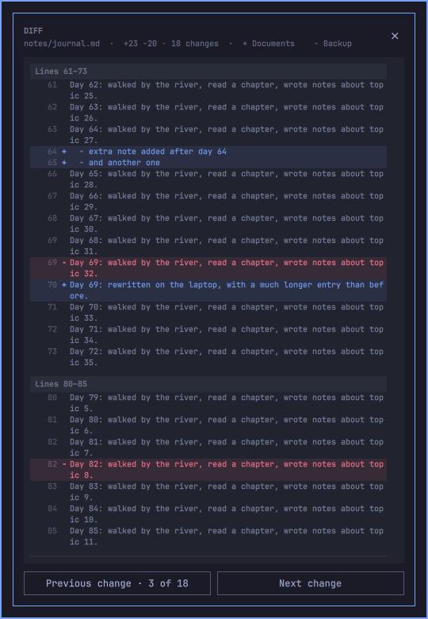
</p>

- **`D`** (or **Diff**) shows a preview in the row: how many lines were added
  and removed, which replica is `+` and which is `−`, and the first lines.
  Press it again to hide it.
- **`F`** (or **View full diff**) opens the whole diff: a section per change
  with its line numbers, and `N`/`P` to jump between changes.
- Binary files show their size on each side. Changes that exist on only one
  side have nothing to compare, so they have no Diff button.

### Sync

<p align="center">
  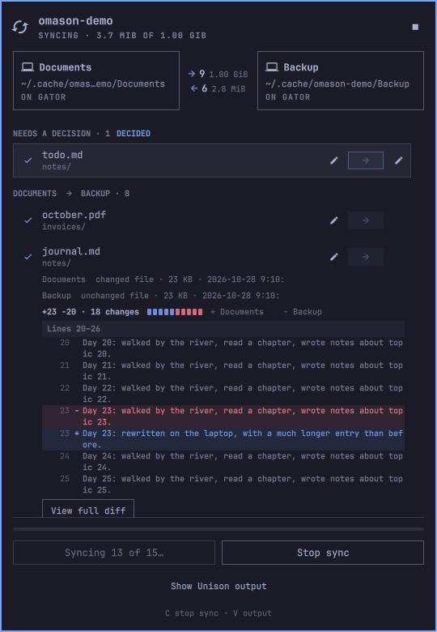
  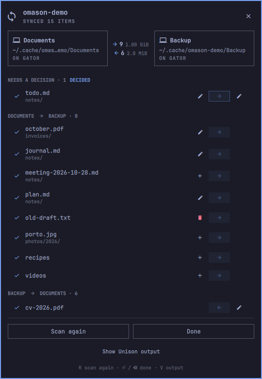
</p>

**Sync N changes** (`G`) applies exactly the directions on screen. Held changes
and untouched conflicts are left alone on both sides. Merges must be given a
direction or held first, because interactive merge tools are not supported.

While it runs, the row being copied spins, finished rows are ticked, and the
title shows the bytes transferred. **Stop sync** (`C`) asks Unison to stop
cleanly; transfers that already completed stay applied. Afterwards, **Scan
again** (`R`) or **Done** (`Backspace`).

Before a sync starts, **Cancel** (`C`) simply ends the review and returns to
the profile: nothing has been copied at that point. You can close the panel
at any time; the session carries on and is there when you reopen it.

### When something goes wrong

<p align="center">
  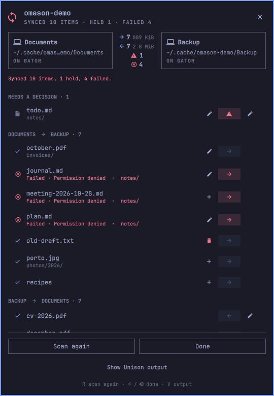
  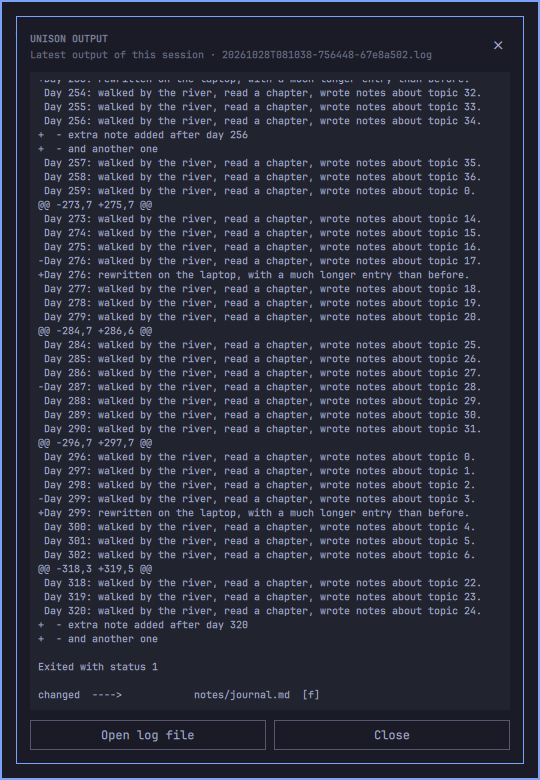
</p>

- **A file fails** (permissions, a full disk, a file changed during the sync):
  its row turns red with Unison's reason, e.g. *Failed · Permission denied*,
  and the rest of the sync still completes. The counts show how many failed.
- **Unison can't run at all**, for example because a replica isn't available:
  the reason is shown in plain words, also under *Last run* on the profile
  screen.
- **A replica is present but empty**, like an unmounted drive's mount point:
  Unison's "a whole replica would be emptied" warning stops the scan until
  you confirm it.
- **Show Unison output** (`V`) opens Unison's raw output in a scrollable
  overlay, with a button to open the session's full log file.

<p align="center">
  
</p>

When a session ends while the panel is closed, a notification reports the
result in generic terms (no profile name or replica paths on the command line).
Open the panel for the detailed message. Clicking the notification reopens it.
The bar icon stays highlighted while a review is waiting, and after an error or
a partial sync.

### Create a profile

<p align="center">
  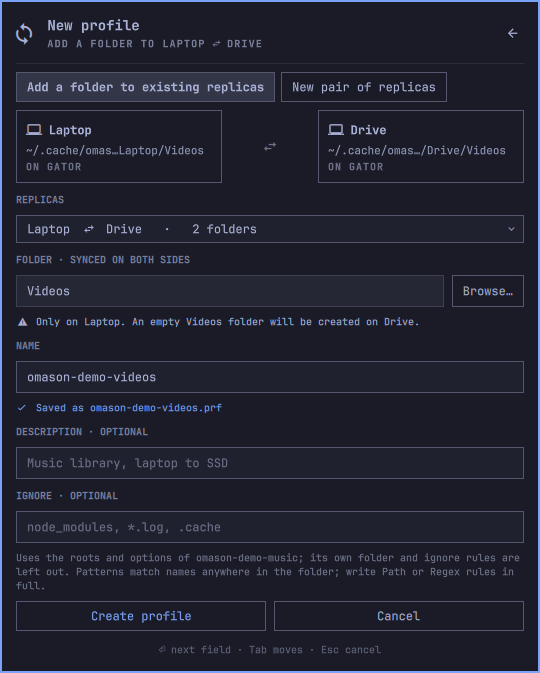
  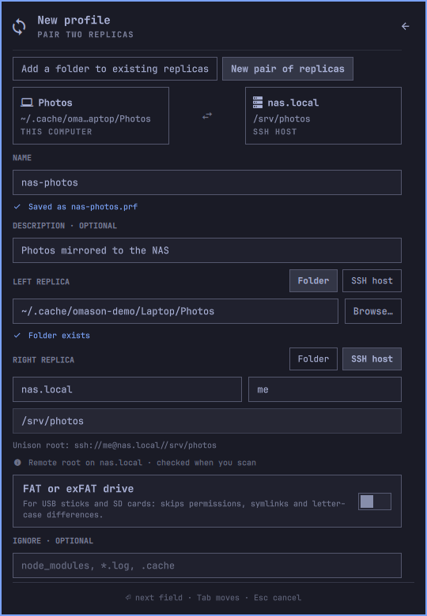
</p>

Press **+** (or `N`). There are two ways to start:

- **Add a folder to existing replicas.** This is for setups where several
  profiles share the same two roots and each syncs one folder (`path = …`),
  such as `laptop-documents` and `laptop-photos`. Choose the replicas, then
  the folder: it is a path inside both, so `Videos` syncs `…/Videos ⇄
  …/Videos`. The new profile copies the options of one of its siblings,
  leaving out that profile's folder, ignore rules and comments, and suggests
  a name with the same prefix. If the siblings use `mountpoint` (Unison's
  guard against an unmounted drive), the folder has to exist on both sides,
  so omaSon creates an empty one where it is missing and tells you before you
  create.
- **New pair of replicas.** Each side is a **Folder** (typed or chosen with
  **Browse…**) or an **SSH host** with host (`nas.local` or `nas:2222`),
  user and path, from which omaSon builds Unison's `ssh://` root. New pairs
  keep five backup versions of replaced files. **FAT or exFAT drive** sets
  Unison's `fat` option, and switches itself on when a folder is on such a
  drive. Plain TCP sockets are not offered because they are unencrypted.

Every field is checked as you type: a folder that doesn't exist, a drive that
isn't mounted, a folder another profile already syncs, a name that is taken.
Problems disable **Create profile**. Both modes take an optional
**Description** (Unison's `label`), shown under the profile name and matched
by the search, and optional ignore patterns: `node_modules, *.log` become
`ignore = Name …` rules, and `Path …` or `Regex …` rules can be written in
full.

### Edit, rename or delete a profile

<p align="center">
  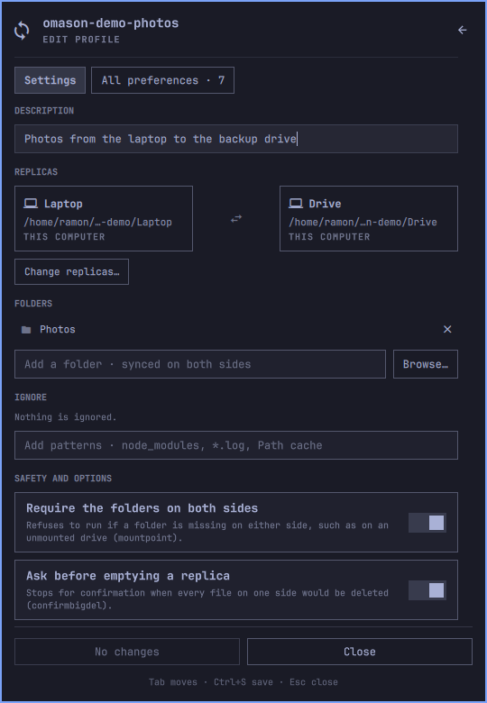
  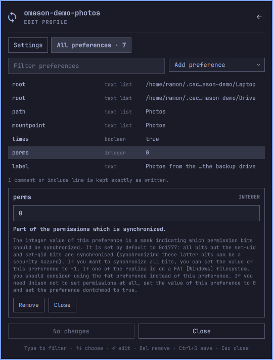
</p>

**Edit** (`E`) opens the selected profile in two tabs:

- **Settings** has the things you usually change: the description, folders,
  ignore patterns, *require the folders on both sides* (`mountpoint`), *ask
  before emptying a replica* (`confirmbigdel`), backups and how many versions
  to keep, and FAT. The replicas are read-only until you choose **Change
  replicas…**, because Unison keys its history to them: after changing them,
  the next scan treats every file as new.
- **All preferences** is the equivalent of Unison's own preference editor:
  every line with its type and value. Select one to edit it and read Unison's
  documentation for it, taken from the installed Unison. Type to filter,
  `↑`/`↓` to choose, `Enter` to edit, `Delete` to remove, and **Add
  preference** for Unison's preferences. Preferences that run programs or
  include other files (`diff`, `merge`, `sshcmd`, …) can only be removed
  here; omaSon forces safe values for them when scanning.

**Save** (`Ctrl+S`) rewrites only the lines you changed: comments, blank
lines, `include` lines and the order stay exactly as they were. Values are
checked against Unison's types, the previous version is kept (the last 10 per
profile), and the file is replaced in one step. A profile that changed on disk
since you opened it isn't overwritten. `Esc` closes the editor; with unsaved
changes it asks for a second `Esc`.

At the bottom of **Settings**:

- **Rename** gives the profile a new name and keeps its history. Unison's
  sync history follows the replicas, not the profile name, so nothing is
  rescanned.
- **Delete profile…** asks for confirmation, then moves the profile file to
  omaSon's state folder, so it can be restored. Your files and Unison's
  archives are left alone, because profiles on the same replicas share them.

None of this works on a profile while it is being reviewed or synced.

### Keyboard

| Key | Action |
| --- | --- |
| `P` | Search profiles |
| `←` `→` (profile screen) | Previous / next profile |
| `↑` `↓` / `J` `K` | Move between controls, changes and the Sync button |
| `Enter` | Scan · expand a change · press the focused button |
| `←` `→` / `H` `L` (review) | Send the focused change to the left / right replica |
| `X` / `U` | Hold the change / restore Unison's suggestion |
| `D` / `F` | Diff preview / full diff (`N` `P` jump between changes) |
| `G` | Sync the shown directions |
| `C` | Cancel the review, or stop the sync |
| `V` | Unison's output (`O` opens the log file) |
| `N` / `R` / `E` | New profile / scan (again) / edit the profile |
| `Backspace` | Leave a finished session, a record or a form |
| `Ctrl+S` | Save the profile being edited |
| `Esc` / `Tab` | Close the panel / switch Omarchy panel |

## How it works

- **Unison does the synchronizing.** It reconciles, transfers, keeps backups,
  locks its archives and detects changes made during a review. omaSon never
  copies replica files itself and never removes Unison's lock files.
- **One Unison process per session.** The helper (`bin/omason`) starts Unison
  in its text interface when you scan and keeps that same process until the
  sync or cancel. Direction changes are queued and applied by moving through
  Unison's list, so the order you change rows in doesn't matter. `batch`,
  `auto`, `silent` and `repeat` are overridden, so a profile can't start
  transferring on its own during a review. There is no scheduled or
  background syncing.
- **SSH never prompts.** It runs with `BatchMode`, existing host keys and a
  15-second connection timeout, so a failed login shows up in the output
  instead of waiting at an invisible password prompt.
- **Tested with Unison 2.54.0** in its English, uncoloured text interface.
  Prompts omaSon doesn't recognise get no automatic answer, and a scan that
  stops producing output times out after two minutes. A future Unison may
  change its text interface and need an update here.
- **One helper for every monitor.** The bar runs one widget per screen; they
  share a single helper over a local socket so every panel sees the same
  session and catalog.

### IPC

```bash
omarchy-shell shell summon io.github.ramoncardena.omason '{}'
omarchy-shell shell hide io.github.ramoncardena.omason
omarchy-shell shell toggle io.github.ramoncardena.omason
```

## Safety and privacy

Like every Omarchy plugin, omaSon runs unsandboxed as your user. Inspect the
source before installing. What it does:

- **Network:** only when a Unison profile uses an SSH (or socket) root — then
  Unison connects to that host. No telemetry and no other outbound requests.
- **Reads:** Unison profiles under `~/.unison` (or `$UNISON`), and the replica
  folders those profiles name (local paths and, for SSH, whatever Unison
  fetches).
- **Writes:** `$XDG_STATE_HOME/omason/` (normally `~/.local/state/omason/`),
  mode `0700`: session logs (capped at about 8 MB each), the newest 50 run
  records, `profile-backups/`, `deleted-profiles/`, and a short-lived serve
  lock/socket under `$XDG_RUNTIME_DIR`. Creating or editing a profile can
  create empty mountpoint folders on local replicas when Unison requires
  them. Unison itself still writes its own archives and backups under
  `~/.unison` when you sync.
- **Processes:** a long-running `python3 bin/omason serve` helper (one shared
  instance), Unison for each scan/sync, a short-lived helper for the portal
  folder chooser, and `omarchy-notification-send` when a session ends while
  the panel is closed. Preferences that run external programs (`diff`,
  `merge`, `sshcmd`, …) cannot be added or changed in the editor; omaSon
  forces safe values for them on the Unison command line.
- No root, no services, no background daemons beyond the shell and that
  helper, and no telemetry.

## Remove

```bash
omarchy plugin remove io.github.ramoncardena.omason --yes
```

Your Unison profiles, Unison's archives and backups, and omaSon's state folder
(`$XDG_STATE_HOME/omason/`) are left in place. Remove the state folder
yourself if you no longer want the history.

## Development

```
manifest.json      Omarchy plugin manifest (bar-widget)
BarWidget.qml      entry point: state, helper process, IPC, bar icon
Panel.qml          the popup (loaded by BarWidget.qml)
Model.js           pure presentation helpers
bin/omason         Unison text-UI bridge; JSON lines on stdin/stdout
scripts/check.sh   integration tests, plugin validation, qmllint
scripts/dev-sync.sh  copy into ~/.config/omarchy/plugins and enable
```

```bash
./scripts/check.sh
```

The tests run real Unison on throwaway folders and never touch your profiles,
replicas or archives. The lint step hides only the dynamic-property warnings
that Omarchy's built-in panels produce too.

`scripts/demo.sh` creates (or resets) demo profiles under
`~/.cache/omason-demo`, which the screenshots above use:

- `omason-demo` (Documents ⇄ Backup) with a conflict, edits including a long
  diff, a binary change, a deletion, and new files on both sides.
- `omason-demo-photos` and `omason-demo-music` (Laptop ⇄ Drive), one folder
  per profile with `mountpoint`, for the "Add a folder" form.

`--big` adds a 1 GB file to watch sync progress, and `--remove` deletes the
demo folders, the demo profiles and only their Unison archives.

The plugin follows the [Omarchy plugin contract](https://plugins.omarchy.org/develop.html),
and the adapter was checked against Unison's
[text UI source](https://github.com/bcpierce00/unison/blob/v2.54.0/src/uitext.ml).
[The design notes](docs/design.md) describe the helper's protocol.

## License

[MIT](LICENSE)
